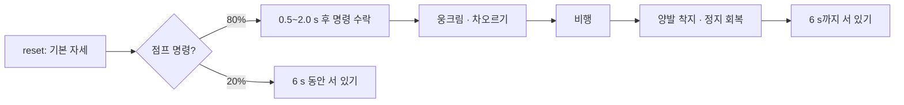
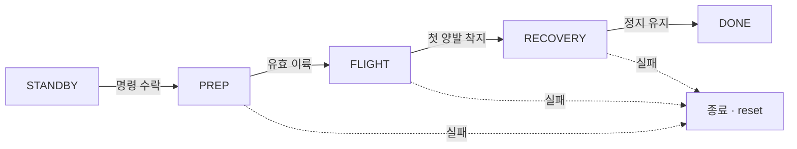
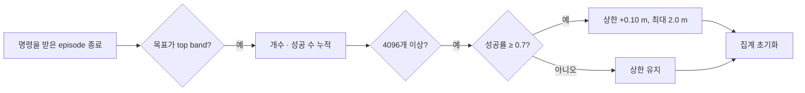

# G1 제자리 멀리뛰기 학습 구성 — Jump와 Ablation

기본 학습 구성은 **Jump**다. 이 문서는 기본 구성의 관측·보상·종료 조건·커리큘럼·제어 설정과, 대칭성·커리큘럼·기본 자세 추종을 각각 제거한 세 ablation을 설명한다. 이하 설정은 학습을 기준으로 한다.

## 목차

- [1. 개요](#1-개요)
- [2. 점프 phase와 용어](#2-점프-phase와-용어)
- [3. Observation](#3-observation)
- [4. Reward](#4-reward)
- [5. Domain randomization](#5-domain-randomization)
- [6. Termination](#6-termination)
- [7. Spawn](#7-spawn)
- [8. 커리큘럼](#8-커리큘럼)
- [9. PD gain, action scale, 기본 자세](#9-pd-gain-action-scale-기본-자세)
- [10. Ablation](#10-ablation)

## 1. 개요

- 과제: 서 있다가 목표 거리 명령을 받으면 한 번 도약하고, 두 발로 착지해 다시 가만히 선다.
- 사람이 정하는 것은 관측·행동 표현·보상·단계 및 성공/실패 판정이다. 정책은 29개 관절을 언제, 얼마나 움직일지 학습한다.
- 준비 중 몸을 낮춘 기록과 위로 차오른 기록을 보상해 동작을 탐색하게 한다.
- 학습 에피소드 하나에는 점프 명령이 최대 한 번이다.

| 항목 | 값 |
| --- | --- |
| Task / variant | `JumpLab-jump` / `jump` |
| 로봇 | Unitree G1, 29관절 위치 제어 |
| 물리 | MjLab + MuJoCo/Warp, timestep 0.005 s = 200 Hz |
| 정책 | decimation 4 → 50 Hz. 이하 step은 정책 step 0.02 s |
| 환경 수 / 에피소드 | 8192 / 6 s = 300 step |
| Actor / Critic 관측 | 103 / 116차원 |
| 보상 / phase / 종료 항목 | 10 / 5 / 10 |
| 알고리즘 | RSL-RL PPO, 환경당 24 step 수집, 기본 학습 반복 10,000회 |
| 신경망 | Actor·Critic 각각 MLP 512–256–128, ELU, 관측 running mean/std 정규화 |
| 행동 분포 | Gaussian, 초기 std 1.0, `std_type="scalar"` |
| PPO | lr 1e-3, adaptive KL 목표 0.01, γ 0.99, λ 0.95, clip 0.2, entropy 0.005 |
| 업데이트 | epoch 5, minibatch 4, value loss 계수 1, clipped value loss, gradient norm 상한 1 |
| 좌우 대칭 | `symmetry` 보상 + mirror loss 계수 1.0 |
| 학습 seed | 42 |

## 2. 점프 phase와 용어

### 2.1 Phase

환경의 상태 기계가 접촉·높이·속도를 보고 phase를 정한다. 정책이 phase를 출력하거나, 정해진 관절 궤적을 재생하지 않는다.

| Phase | 해야 할 일 | 보상에서 사용하는 묶음 |
| --- | --- | --- |
| STANDBY | 기본 자세로 서서 명령 대기 | 서기 |
| PREP | 웅크리고 지면을 차고 오르기 | 점프 |
| FLIGHT | 공중에서 착지 준비 | 점프 |
| RECOVERY | 착지 후 기본 자세와 정지 상태 회복 | 서기 |
| DONE | 남은 에피소드 동안 서 있기 | 서기 |

이하 **서기** = STANDBY·RECOVERY·DONE, **점프** = PREP·FLIGHT다. PREP 안에서 웅크리는 시간과 차오르는 시간은 별도 phase로 나누지 않는다.

### 2.2 전이 조건

| 전이 | 조건 |
| --- | --- |
| STANDBY → PREP | reset 때 정한 수락 시각 도달. 정지 여부를 기다리지 않음 |
| PREP → FLIGHT | 양발 비접촉 3 step 연속, 두 발바닥 최저점 ≥ 0.03 m, 명령 시점 대비 COM 상승 ≥ 0.03 m, COM 수직 속도 > 0, 골반 기울기 < 50° |
| FLIGHT → RECOVERY | 유효 비행 이후 두 발이 모두 접촉 |
| RECOVERY → DONE | 재도약하지 않고 정지 상태를 0.35 s 연속 유지 |

이륙·착지·회복 완료 이벤트는 해당 전이가 일어나는 한 step에만 켜진다.

### 2.3 용어와 성공 판정

| 용어 | 정의 |
| --- | --- |
| 목표 거리 $d$ | 출발 대비 뒤쪽 뒤꿈치의 전방 이동 목표 (m) |
| 기준 좌표계 | 명령 수락 순간의 골반 수평 위치와 yaw로 고정. x는 전방, y는 좌측 |
| 이동 거리 $\Delta$ | 착지 시 뒤쪽 뒤꿈치 x − 명령 수락 시 뒤쪽 뒤꿈치 x |
| 공식 기록 $D$ | 착지 시 뒤쪽 뒤꿈치 x − 출발 시 앞쪽 발끝 x. 발이 나란하면 $D=\Delta-0.206$ m |
| COM | 전체 로봇 body COM을 질량으로 가중 평균한 질량 중심 |
| apex | PREP·FLIGHT 동안 COM의 명령 수락 시점 대비 최고 상승량 |
| $t_{cmd}$ | 명령 수락 이후 경과 시간. 착지 후에도 증가 |
| 골반 / 몸통 기울기 | pelvis / torso_link가 수직에서 벗어난 각도 |
| 기본 자세 오차 $E$ | 전 관절의 $\sum_j(q_j-q_j^0)^2$ |
| 성공 | DONE 도달 + $\lvert\Delta-d\rvert\le0.10+0.05d$ m + 횡방향 오차 ≤ 0.08 m + yaw 오차 ≤ 15° |

성공은 유효 이륙·착지·정지 회복과 목표 오차로 결정한다. 높이는 `land` 보상의 크기에 반영된다.

| 정지 판정 | 학습 조건 |
| --- | --- |
| 양발 접촉 | 필요 |
| 골반 선속도 norm | < 0.30 m/s |
| 골반 각속도 norm | < 1.0 rad/s |
| 골반 및 몸통 기울기 | 각각 < 12° |
| 속도 저역 필터 | 시정수 0.20 s |

확률적 행동이 만드는 진동을 고려해 속도를 필터링한다. `still` 보상은 현재 속도를 사용하며 기준값은 각각 0.15 m/s, 0.5 rad/s다.

**접촉 측정의 구분:** 발 접촉 임계값은 힘 벡터 norm > 5 N이다. FSM은 최근 물리 4 substep 이력 중 최대값을 이용해 순간적인 접촉을 놓치지 않도록 한다. Actor의 `feet_contact` 관측은 현재 센서 힘의 norm을 이용한다. 두 값의 임계값은 같지만 시간 집계 방식은 다르다.

## 3. Observation

### 3.1 입력 항목과 순서

등록 순서대로 concatenate한다. Actor는 아래 첫 9개 항목, Critic은 Actor 전체에 4개 항목을 추가한다.

| 항목 | 차원 | Actor | Critic | 내용 |
| --- | ---: | :---: | :---: | --- |
| `base_lin_vel` | 3 | O | O | 골반 좌표계의 선속도 IMU 센서 |
| `base_ang_vel` | 3 | O | O | 골반 좌표계의 각속도 IMU 센서 |
| `projected_gravity` | 3 | O | O | 골반 좌표계의 중력 방향 |
| `joint_pos` | 29 | O | O | 관절 각도 − 기본 자세 |
| `joint_vel` | 29 | O | O | 관절 속도 − 기본 속도. 기본 속도는 0 |
| `actions` | 29 | O | O | 직전 행동 |
| `pelvis_height` | 1 | O | O | 골반의 world z 높이 |
| `feet_contact` | 2 | O | O | 왼발·오른발 접촉 0/1 |
| `jump_cue` | 4 | O | O | `[PREP, FLIGHT, d, t_cmd]`. 서기 phase에서는 모두 0 |
| `phase` | 5 | | O | 5개 phase one-hot |
| `jump_time` | 1 | | O | 명령 후 시간. 명령 전 0, 회복·완료에서도 유지 |
| `landing_error` | 4 | | O | 전방 오차, 횡방향 오차, sin(yaw 오차), cos(yaw 오차) |
| `jump_record` | 3 | | O | 최대 웅크림 깊이, 최고 상승 속도, apex |
| **합계** | | **103** | **116** | |

### 3.2 마스크와 기록

- Actor의 서기 phase에는 과제 신호 `jump_cue`가 모두 0이다. phase를 직접 알려 주지 않는다는 뜻이며, 나머지 몸 상태까지 같다는 뜻은 아니다.
- `landing_error`는 착지 전에는 현재 뒤꿈치·발 중심·yaw로 계산하고, 첫 양발 착지 후에는 그때의 오차를 고정한다. 명령 전에는 cos 항까지 포함해 네 값 모두 0이다.
- `jump_record`는 reset 또는 새 명령 수락 때 초기화한다. 깊이 기록 자체는 0.15 m를 넘을 수 있지만 `crouch` 지급액은 0.15 m에서 포화한다. 최고 상승 속도 기록은 Jump의 2.5 m/s 상한을 적용한다.
- Critic은 회복 중에도 단계·시간·착지 오차·점프 기록을 본다. 이 추가 정보는 Actor의 행동 입력에는 들어가지 않는다.
- 직전 행동과 FSM 기록은 시간 정보를 요약한 입력이다.
- Actor·Critic 모두 running mean/std 정규화를 사용한다.

### 3.3 좌우 반전과 mirror loss

[mdp/symmetry.py](../src/jump_lab/training/mdp/symmetry.py)가 관측과 행동의 반전 규칙을 정의한다. 좌우 관절과 발 접촉을 교환하고, roll·yaw 계열의 부호를 바꾼다. `landing_error`의 부호는 `[+, −, −, +]`이며 phase·시간·기록은 그대로다.

| 대칭 장치 | 어디에 작용하나 | Jump 설정 |
| --- | --- | --- |
| `symmetry` reward | 실제 로봇의 준비·비행 자세가 비대칭이면 환경 보상에서 감점 | weight −2 |
| mirror loss | 반전 관측에 대한 정책의 평균 행동과 반전한 평균 행동을 비교하는 학습 손실 | 계수 1.0 |

자세 대칭 보상은 로봇 상태에, mirror loss는 정책의 입력–출력 관계에 작용한다.

## 4. Reward

### 4.1 표기와 지급 단위

공통 점수 함수는 다음과 같다.

$$
M(e)=\frac{1}{1+e},\qquad e\ge0.
$$

오차 0이면 1, 정규화된 오차 1이면 0.5다. 함수에 들어가기 전에 제곱하는 항과 이미 제곱합인 항을 구분한다.

| 기호 | 뜻 |
| --- | --- |
| $E$ | 기본 자세 관절 오차 제곱합 $\sum_j(q_j-q_j^0)^2$ |
| $A_{sym}$ | $\frac12\sum_j(q_j-s_jq_{mirror(j)})^2$. 좌우 짝 중복을 절반으로 보정하며 허리 roll·yaw도 포함 |
| $e_x,e_y,e_\psi$ | 첫 양발 착지에서 측정한 전방 거리·횡방향·yaw 오차 |
| $h^*$ | 높이 만점 기준 $\max(0.30,0.10+0.18d)$ m. 목표 2 m에서는 0.46 m |
| $H$ | $\operatorname{clip}(apex/h^*,0,1)$ |
| $\delta h_{record}$ | 이번 step에 새로 경신한 웅크림 깊이 중 0.15 m 이하에 해당하는 부분 |
| $\delta v_{record}$ | 이번 step에 새로 경신한 상승 속도. 기록 상한 2.5 m/s |

MjLab reward manager는 **모든 항목에 weight와 정책 dt를 곱한다.** 아래 표는 이 처리를 거친 실제 지급 의미다. 이벤트·기록 증가 보상 함수는 내부에서 dt로 나누므로 정책 주기를 바꿔도 같은 이벤트의 지급액이 중복 적분되지 않는다.

| 방식 | 의미 |
| --- | --- |
| 초당 | 해당 조건 동안 매 step 지급. 표의 값 × 0.02 s가 실제 한 step 보상 |
| 기록 증가 | 이전 기록을 넘어선 증가분에만 지급. 반복해 같은 깊이·속도에 도달해도 추가 보상 없음 |
| 1회 | 이벤트 또는 실패 종료 step에 한 번 지급 |

### 4.2 전체 표

| 이름 | weight | 언제 | 방식 | weight 적용 전 점수/비용 | 역할 |
| --- | ---: | --- | --- | --- | --- |
| `pose` | +3.0 | 서기 | 초당 | $M(E/0.30)$ | 기본 자세로 서기 |
| `still` | −0.25 | 서기 | 초당 | 네 가지 정지 비용의 합 | 기울기·속도·위치 이탈 억제 |
| `alive` | +1.0 | 서기 | 초당 | 1 | 초기 생존 학습 보조 |
| `prep_time` | +4.0 | PREP이고 $t_{cmd}<0.6$ s | 초당 | 1 | 준비 시간의 보상 공백 보완 |
| `crouch` | +2.0 | PREP, 양발 접촉·균형 조건 | 기록 증가 | $\delta h_{record}/0.15$ | 몸을 낮추기 |
| `push` | +1.0 | PREP, 골반 기울기 < 50° | 기록 증가 | $\delta v_{record}/2.5$ | 위로 차오르기 |
| `land` | +5.0 | 첫 양발 착지 | 1회 | $M((e_x/0.15)^2)M((e_y/0.10)^2+(e_\psi/20°)^2)(0.4+0.6H)$ | 정확도·방향·높이 |
| `symmetry` | −2.0 | PREP·FLIGHT | 초당 | $1-M(A_{sym}/0.40)$ | 좌우 비대칭 억제 |
| `smooth` | −0.1 | 항상 | 초당 | $\sum_j(a_{j,t}-a_{j,t-1})^2$ | 급격한 행동 변화 억제 |
| `fail` | −2.0 | 실패 종료 | 1회 | 1 | 넘어짐·과제 실패 감점 |

### 4.3 서기: pose, still, alive

`pose`는 서기 phase에서 기본 자세에 가까울수록 커지는 점수 함수다.

`still`의 비용은 다음과 같다.

$$
\begin{aligned}
C_{\mathrm{still}} ={}& \min\!\left[\left(\frac{\theta_{\mathrm{torso}}}{12^\circ}\right)^2,1\right]
+ \min\!\left[\left(\frac{\lVert v_{\mathrm{pelvis}}\rVert}{0.15}\right)^2,1\right] \\
&+ \min\!\left[\left(\frac{\lVert \omega_{\mathrm{pelvis}}\rVert}{0.5}\right)^2,1\right]
+ \min\!\left[\left(\frac{\lVert p_{xy}-p_{xy}^{\mathrm{anchor}}\rVert}{0.10}\right)^2,1\right], \\
r_t^{\mathrm{still}} ={}& -0.25\,C_{\mathrm{still}}\,\Delta t
\qquad (\text{서기 phase}).
\end{aligned}
$$

- 기울기는 **몸통** 기준이다. 정지 성공 판정은 골반과 몸통 둘 다 검사한다.
- 속도는 현재 측정값이며, 정지 판정과 달리 0.15 m/s, 0.5 rad/s 기준으로 비용을 계산한다.
- 수평 기준점은 reset 후 첫 FSM 갱신의 골반 위치다. 첫 착지 때 착지 위치로 바꾼다.
- 네 항목은 각각 1에서 포화한다. 따라서 `still`은 최대 −1/s다.

`alive`는 서기 phase라는 이유로 +1/s를 준다. 별도로 “잘 서 있는지” 검사하는 보상은 아니다. 실제 생존 여부는 종료 조건이 결정한다. 이상적인 서기에서 `pose + alive`는 최대 +4/s이며 `still`과 `smooth`는 별도로 감점한다.

### 4.4 준비: prep_time, crouch, push

**prep_time**

- PREP에 들어가면 서기 보상 `pose + alive`가 사라진다. 첫 0.6 s에 +4/s를 주어 바로 이륙하지 않고 준비하는 행동의 보상 공백을 보완한다.
- 0.6 s 동안 기다리도록 강제하지 않는다. 먼저 이륙하면 PREP를 벗어나 지급이 끝난다.
- 충분히 오래 PREP에 있으면 총량은 약 +2.4다. 이후에는 기다려도 이 항목을 더 받지 못한다.

**crouch**

- 깊이 = 명령 수락 당시 COM 높이 − 현재 COM 높이.
- PREP이며 양발이 접촉하고, COM의 기준 좌표계 x가 **출발 뒤쪽 뒤꿈치 −0.02 m와 앞쪽 발끝 +0.02 m 사이**에 있을 때만 기록을 갱신한다. 이것은 전방 균형 조건이며, 완전한 2D 지지 다각형 판정은 아니다.
- 새 기록에서 이전 기록을 뺀 증가분만 지급한다. 지급할 깊이는 0.15 m에서 포화하므로 한 번의 점프에서 최대 +2다.
- 예: 0 → 0.05 → 0.10 → 0.06 → 0.10 → 0.15 m 순서로 낮아지면, 보상은 약 +0.667, +0.667, 0, 0, +0.667이다.
- 기록 자체는 0.15 m를 넘어갈 수 있으며 Critic 입력에도 사용된다.

**push**

- PREP이고 골반 기울기가 50° 미만일 때 COM 수직 속도 최고 기록의 증가분을 지급한다.
- 상한은 거리와 무관하게 **2.5 m/s**다. 기록은 0에서 시작하므로 하강 속도에는 보상을 주지 않는다. 한 점프의 총 보상은 최대 +1이다.

깊이·속도 기록은 이륙하는 step까지 갱신한다. 기록은 reset과 새 명령 수락 때 초기화되므로, 이전 에피소드의 기록을 이어받지 않는다.

### 4.5 착지: land

$$
\begin{aligned}
S &= \frac{1}{1+(e_x/0.15)^2}, \\
L &= \frac{1}{1+(e_y/0.10)^2+(e_\psi/(20^\circ))^2}, \\
h^* &= \max(0.30,\;0.10+0.18d), \\
H &= \operatorname{clip}\!\left(\frac{h_{\mathrm{apex}}}{h^*},\;0,\;1\right), \\
r_t^{\mathrm{land}} &= \mathbf{1}_{\mathrm{landing},t}\;5SL(0.4+0.6H).
\end{aligned}
$$

| 상황 | 착지 보상 |
| --- | ---: |
| 거리·방향 오차 0, 높이 만점 | +5 |
| 전방 오차 0.15 m, 나머지 만점 | +2.5 |
| 전방 오차 0, 옆 오차 0.10 m, yaw 0, 높이 만점 | +2.5 |
| 거리·방향 오차 0, 높이 비율 0.5 | +3.5 |

첫 양발 착지에서 한 번만 지급한다. 높이와 방향·거리 점수를 곱하므로 높이만 뛰거나 목표에서 크게 벗어나면 점수가 줄어든다. `land` 지급 시점에 아직 착지 후 정지가 보장된 것은 아니다. 회복은 이후의 `pose`, `still`, `alive`와 실패 규칙이 유도한다.

### 4.6 동작 품질과 실패: symmetry, smooth, fail

- `symmetry`: 좌우 관절 각도를 대응시켜 비교한다. roll·yaw는 부호를 뒤집으며 허리 관절도 포함한다. $1-M(A_{sym}/0.40)$는 비대칭이 클수록 1에 가까워져 감점이 포화한다. 실제 상태에 대한 환경 보상이며 mirror loss와 구분한다.
- `smooth`: 모든 phase·모든 관절에 동일한 action 차이 제곱합을 적용한다.
- `fail`: `termination_manager.terminated`일 때 −2를 지급한다. 정상 6초 time limit은 timeout이므로 제외한다.

### 4.7 점수 규모 읽기

| 항목 | 한 점프에서의 최대 지급 규모 |
| --- | ---: |
| 준비 시간 | 약 +2.4 |
| 웅크림 기록 | +2 |
| 상승 속도 기록 | +1 |
| 첫 착지 | +5 |
| 위 네 항목의 합 | 약 +10.4 |

이 합은 전체 episode return이 아니다. 서기 phase의 연속 보상과 symmetry·smooth·실패 비용이 따로 더해진다. 따라서 구성별 총 reward만 비교해서 어느 정책이 더 잘 뛰는지 판단하지 않는다.

## 5. Domain randomization

### 5.1 Reset과 명령 샘플링

| 항목 | 학습 분포 |
| --- | --- |
| 초기 yaw | U(−π, π) |
| 초기 관절 각도 | 기본 자세 + 관절마다 U(−0.05, 0.05) rad, soft limit 범위로 clamp |
| 초기 root·관절 속도 | 0 |
| 명령 수락 시각 | U(0.5, 2.0) s |
| 목표 거리 | 전체 구간과 top band의 혼합. [8장](#8-커리큘럼) |
| 명령 없는 episode | 확률 0.2. 수락 시각을 무한대로 설정 |

### 5.2 고정된 물리·센서 조건

| 항목 | 설정 |
| --- | --- |
| 지형 | 평지 |
| 발 마찰 계수 | 0.6 |
| 질량·COM·관성 | MjLab G1 모델 값 |
| Self-collision | 활성. G1 `FULL_COLLISION` 설정 사용 |
| PD gain·토크 한계 | [9장](#9-pd-gain-action-scale-기본-자세) |

## 6. Termination

항상 검사하는 네 항목과 FSM의 여섯 실패 코드로 총 10개 항목이다.

| 검사 범위 | 이름 | 조건 |
| --- | --- | --- |
| 항상 | `time_out` | 6 s 도달. 정상 time limit |
| 항상 | `fell_over` | 골반 기울기 > 65° |
| 항상 | `pelvis_low` | 골반 높이 < 0.25 m |
| 항상 | `body_ground_contact` | 발 이외 body의 지면 접촉 힘 norm > 10 N. substep 이력 최대값 사용 |
| PREP | `prep_step` | 접촉 중인 발끝이 명령 수락 위치에서 0.05 m 넘게 이동 |
| PREP | `no_takeoff` | 명령 후 1.5 s가 지나도 유효 이륙 없음 |
| FLIGHT | `flight_timeout` | 이륙 후 1.0 s가 지나도 양발 착지 없음 |
| FLIGHT | `one_foot_landing` | 첫 발 접촉 후 0.10 s가 지나도 양발 접촉이 되지 않음 |
| RECOVERY | `second_hop` | 양발 비접촉 3 step + 발바닥 최저점 ≥ 0.03 m |
| RECOVERY | `recovery_timeout` | **명령 후** 3.5 s가 지나도 정지 회복 미완료 |

- 정상 6초 `time_out` 이외의 종료는 해당 step에 episode를 끝내고 `fail` −2를 준다. `flight_timeout`, `recovery_timeout`도 이름에 timeout이 있지만 실패 종료다.
- PPO는 정상 time limit에 대해 Critic으로 bootstrap한다. timeout 자체가 과제 성공이라는 뜻은 아니다.
- 발끝을 기준으로 이동을 검사하므로 뒤꿈치를 들며 차오르는 것은 허용한다.
- 유효 이륙과 발 이동 실패가 동시에 검출되면 해당 step의 유효 이륙이 우선된다. FSM은 첫 실패 코드를 보존한다.
- DONE은 성공을 저장하고 남은 episode에서 서기 보상을 계속 받는다. 이후 낙상은 실패 종료가 되지만 이미 저장한 `success` 값은 유지된다.
- `second_hop` 종료 조건의 검사 범위는 RECOVERY다.

## 7. Spawn

| 항목 | 기본값 |
| --- | --- |
| 지형 / 환경 간격 | 평지 / 3 m |
| 골반 위치 | 환경 원점 x·y, z 약 0.71995 m |
| 방향 | yaw $U(-\pi,\pi)$, roll·pitch 0 |
| 관절 | 기본 자세 + U(−0.05, 0.05) rad |
| 속도 | root·관절 모두 0 |
| Phase / 기록 | STANDBY / 기록 초기화 |

항상 기본 서기 자세 부근에서 시작한다. 공중·웅크림·착지 자세에서 임의로 시작하지 않는다. reset의 골반 높이는 기본 무릎 각에 따라 계산되며, 위 값은 `STANCE_KNEE = 1.0`일 때다.

## 8. 커리큘럼

| 항목 | 값 |
| --- | --- |
| 조절 변수 | 목표 거리 상한 `delta_max` |
| 초기 / 최대 | 0.30 / 2.0 m |
| 증가량 | 0.10 m |
| Top band | `[delta_max − 0.10, delta_max]` |
| 승급 조건 | 명령을 받은 top band episode가 4096개 이상 모이고 성공률 ≥ 0.7 |
| 실패 시 | 상한 유지 |
| 판정 후 | 승급 여부와 무관하게 집계 초기화 |

목표는 reset마다 확률 0.5로 U(0, `delta_max`), 나머지 0.5로 U(`delta_max` − 0.10, `delta_max`)에서 뽑는다. 전체 구간 샘플에도 top band가 포함되므로 실제 top band 비율은 정확히 50%보다 크다.

성공은 탐색 noise가 있는 학습 행동과 학습용 정지 판정으로 집계한다. 명령 전 실패와 명령 없는 episode는 이 top band 성공률의 분모에 들어가지 않는다.

## 9. PD gain, action scale, 기본 자세

### 9.1 행동에서 토크까지

$$
\begin{aligned}
q_{j,t}^{\mathrm{target}} &= q_j^0 + s_j a_{j,t}, \\
\tau_{j,t} &= \operatorname{clip}\!\left(
 k_{p,j}(q_{j,t}^{\mathrm{target}}-q_{j,t})-k_{d,j}\dot q_{j,t},
 -\tau_j^{\max},\;\tau_j^{\max}\right), \\
s_j &= 0.25\,\frac{\tau_j^{\max}}{k_{p,j}}.
\end{aligned}
$$

행동 $a_{j,t}$를 관절 목표 각도로 변환하고, PD 제어 토크를 effort limit에서 제한한다. 아래는 설치된 MjLab G1 `BuiltinPositionActuatorCfg` 값이다.

| 관절 | kp (Nm/rad) | kd (Nm·s/rad) | 토크 한계 (Nm) | action scale (rad) |
| --- | ---: | ---: | ---: | ---: |
| hip_pitch, hip_yaw, waist_yaw | 40.179 | 2.558 | 88 | 0.5475 |
| hip_roll, knee | 99.098 | 6.309 | 139 | 0.3507 |
| ankle_pitch, ankle_roll | 28.501 | 1.814 | 50 | 0.4386 |
| waist_pitch, waist_roll | 28.501 | 1.814 | 50 | 0.4386 |
| shoulder_pitch/roll/yaw, elbow, wrist_roll | 14.251 | 0.907 | 25 | 0.4386 |
| wrist_pitch, wrist_yaw | 16.778 | 1.068 | 5 | 0.0745 |

- kp·kd는 반영된 모터 관성과 고유 진동수 10 Hz, 감쇠비 2로 설정한다.
- soft limit은 관절 범위의 가운데 90%이며 reset 시 관절 각도 clamp에 사용한다.

### 9.2 기본 자세

| 관절 | 기본 각도 (rad) |
| --- | ---: |
| hip_pitch (좌·우) | −0.5 |
| knee (좌·우) | 1.0 |
| ankle_pitch (좌·우) | −0.5 |
| elbow (좌·우) | 0.6 |
| shoulder_pitch (좌·우) | 0.2 |
| shoulder_roll (좌 / 우) | +0.2 / −0.2 |
| 나머지 | 0 |

기본 자세는 reset 기준, action 0의 목표, `pose` 보상 기준, `joint_pos` 상대 관측 기준에 공통으로 쓰인다.

## 10. Ablation

세 구성은 모두 **Jump를 출발점으로 각각 독립적으로** 학습한다. 앞 실험에서 제거한 항목을 다음 실험에 누적해서 빼는 방식이 아니다.

### 10.1 구성 비교

| 항목 | Jump | `no_symmetry` | `no_curriculum` | `no_pose` |
| --- | --- | --- | --- | --- |
| 전체 variant 이름 | `jump` | `jump_no_symmetry` | `jump_no_curriculum` | `jump_no_pose` |
| 제거하는 요소 | 기준 구성 | `symmetry` reward + PPO mirror loss | 목표 거리 상한을 올리는 curriculum | `pose` reward |
| 보상 수 | 10 | 9 | 10 | 9 |
| `pose` reward | +3 | +3 | +3 | 제거 |
| `symmetry` reward | −2 | 제거 | −2 | −2 |
| Mirror loss 계수 | 1.0 | 제거 | 1.0 | 1.0 |
| 목표 거리 상한 | 0.3 m에서 시작, 최대 2 m | Jump와 같음 | 처음부터 2 m 고정 | Jump와 같음 |
| Actor / Critic 입력 | 103 / 116 | 103 / 116 | 103 / 116 | 103 / 116 |
| 환경 수 / 학습 반복 | 8192 / 10k | 8192 / 10k | 8192 / 10k | 8192 / 10k |

로봇, 물리 주기, 기본 자세, reset 분포, action scale, 신경망 크기, PPO 설정과 종료 조건은 공통이다. 관측이나 보상을 바꾸는 항목은 위 표에 명시된 것뿐이다.

### 10.2 대칭성 제거: no_symmetry

서로 다른 두 대칭성 장치를 함께 제거한다.

| 제거 항목 | Jump에서의 역할 | 코드 변경 |
| --- | --- | --- |
| `symmetry` reward | PREP·FLIGHT에서 실제 관절 자세의 좌우 비대칭에 감점 | `cfg.rewards`에서 `symmetry` 삭제 |
| Mirror loss | 반전된 관측에 반전된 평균 행동을 내도록 Actor 학습 | PPO의 `symmetry_cfg = None` |

기본 자세 추종, 양발 이륙·착지 조건, 전방 착지 보상은 유지한다. 따라서 명시적인 두 대칭성 항을 제거하더라도 기본 자세와 과제 조건 자체에 있는 좌우 대칭 구조는 남는다.

이 실험은 **목표 거리를 수행하는 능력**과 **동작의 좌우 대칭성**을 구분해서 볼 수 있게 한다.

### 10.3 커리큘럼 제거: no_curriculum

거리 상한을 성공률에 따라 늘리는 과정을 제거하고, 처음부터 Jump의 최종 목표 분포를 사용한다.

$$
\delta_{\max}=2.0\ \mathrm{m},\qquad
 d\sim
 \begin{cases}
 \mathcal{U}(0,2.0) & \text{확률 }0.5,\\
 \mathcal{U}(1.9,2.0) & \text{확률 }0.5.
 \end{cases}
$$

| 항목 | Jump | no_curriculum |
| --- | --- | --- |
| 시작 거리 상한 | 0.30 m | 2.0 m |
| 상한 갱신 | 상위 구간 성공률에 따라 +0.10 m | 갱신 없음 |
| 환경 설정 | `target_distance` curriculum 사용 | `cfg.curriculum = {}` |
| 목표 샘플링 | 전체 구간 50% + 상위 0.10 m 구간 50% | 같은 비율, 구간만 처음부터 최종 범위 |

항상 2 m만 지시하는 실험이 아니다. 명령 없는 에피소드 20%, 명령 시각 분포, 보상 10개, mirror loss는 유지한다.

이 실험은 **쉬운 거리에서 시작해 성공 경험을 쌓는 과정**이 최종 거리 학습에 주는 영향을 확인한다.

### 10.4 기본 자세 추종 제거: no_pose

서기 phase에 적용되던 다음 보상만 제거한다.

$$
r_t^{\mathrm{pose}}
=\mathbf{1}_{\{\mathrm{STANDBY},\mathrm{RECOVERY},\mathrm{DONE}\}}
\;\frac{3}{1+\sum_j(q_j-q_j^0)^2/0.30}\;\Delta t.
$$

| 기본 자세가 사용되는 곳 | no_pose에서의 처리 |
| --- | --- |
| STANDBY·RECOVERY·DONE의 `pose` reward | 제거 |
| Reset 때의 관절 각도 기준 | 유지 |
| Action 0의 관절 목표 각도 | 유지 |
| `joint_pos` 상대 관측의 기준 | 유지 |

`still`, `alive`, `symmetry`, mirror loss와 종료 조건도 유지한다. 기본 자세 자체를 지우거나, 임의 자세에서 시작하게 하는 실험은 아니다.

이 실험은 **관절별로 기본 자세에 돌아오게 하는 보상**이 명령 전 대기와 착지 후 자세 회복에 주는 영향을 확인한다.

### 10.5 코드 위치

| 내용 | 파일 |
| --- | --- |
| 세 ablation의 설정 차이 | [ablations.py](../src/jump_lab/training/ablations.py) |
| 보상 계산식 | [mdp/rewards.py](../src/jump_lab/training/mdp/rewards.py) |
| 로봇·물리·센서·reset·종료 조건 | [env_cfg.py](../src/jump_lab/training/env_cfg.py) |
| PPO·신경망·mirror loss 설정 | [rl_cfg.py](../src/jump_lab/training/rl_cfg.py) |
| 단계 전이·점프 기록·성공/실패 판정 | [mdp/fsm.py](../src/jump_lab/training/mdp/fsm.py) |
| 접촉·COM·자세 측정 | [mdp/jump_command.py](../src/jump_lab/training/mdp/jump_command.py) |
| 관측 계산 | [mdp/observations.py](../src/jump_lab/training/mdp/observations.py) |
| 거리 커리큘럼 | [mdp/curriculum.py](../src/jump_lab/training/mdp/curriculum.py) |
| 좌우 관측·행동 반전 | [mdp/symmetry.py](../src/jump_lab/training/mdp/symmetry.py) |
